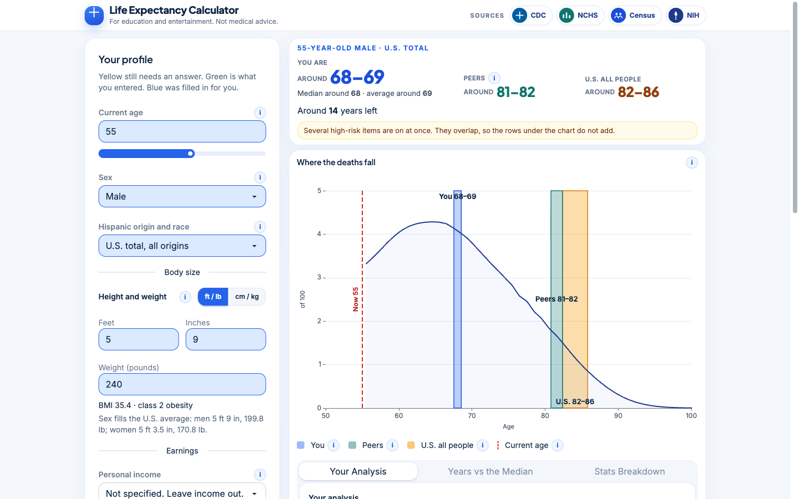

# Life Expectancy Calculator

One page, for education and entertainment. Not medical advice.

Enter age, sex, and origin. The page compares that profile with peers on the same CDC life table, and with everyone in the United States. Height, weight, smoking, activity, illness, and personal income are optional.

Open `index.html` in a browser.

The picture is the built-in example: a 55-year-old man, U.S. total, current smoker, 5 ft 9 in, 240 lb, with diabetes. Sources are listed on the page.
